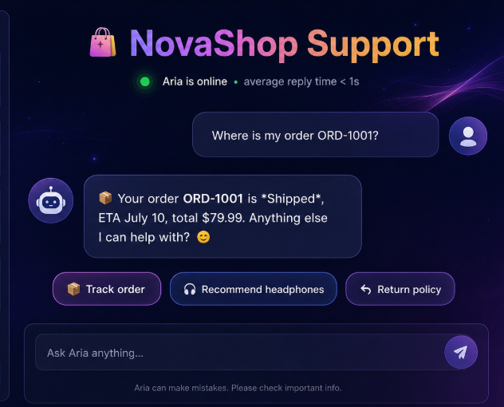
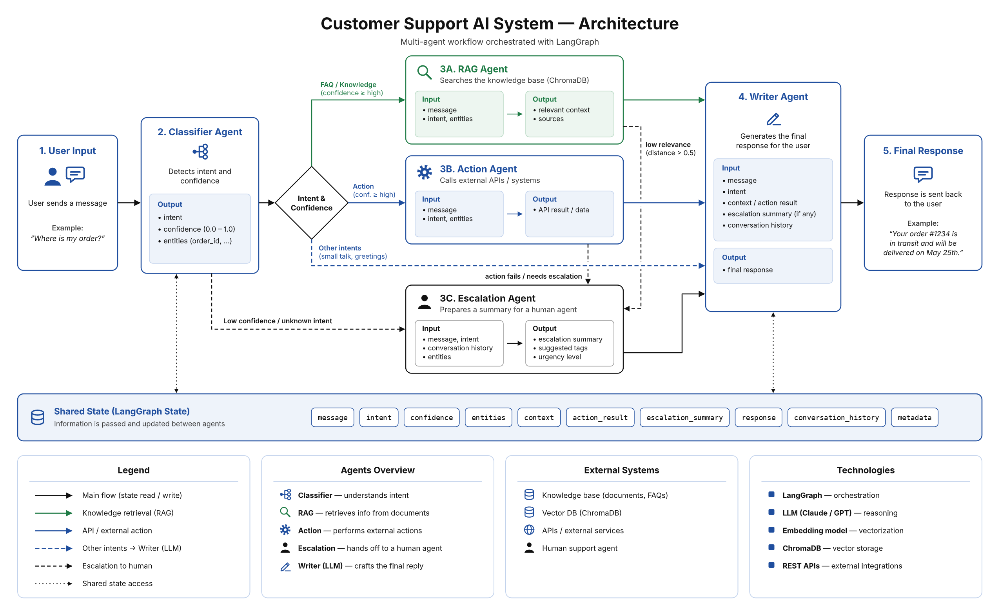

# Assistant de Support Client Intelligent Multi-Agents

<p align="center">
  <strong>Un assistant conversationnel intelligent pour automatiser le support client d'une plateforme e-commerce.</strong>
</p>

<p align="center">
  
  
  
  
  
  
</p>

---

<p align="center">
  
</p>

## Présentation

**Assistant de Support Client Intelligent** est une application de support client basée sur une architecture multi-agents orchestrée avec **LangGraph**.

Le projet vise à automatiser le traitement des demandes d'un site e-commerce fictif spécialisé dans les produits électroniques.

Contrairement à un chatbot classique, l'assistant analyse les demandes, identifie leur intention, sélectionne le traitement approprié et peut déclencher des actions métier simulées ou transférer une demande à un conseiller humain.

Le système intègre une authentification progressive : un visiteur peut poser des questions générales sans créer de compte, tandis que les opérations nécessitant une identification déclenchent une demande de connexion.

### Fonctionnalités principales

- **Classification intelligente :** identification de l'intention et extraction des informations utiles.
- **RAG :** recherche documentaire avec ChromaDB pour produire des réponses fondées sur la base de connaissances.
- **Actions métier :** consultation du statut des commandes et vérification de l'éligibilité des remboursements à travers des fonctions Python.
- **Escalade humaine :** génération d'un résumé et création d'un ticket pour le conseiller.
- **Authentification JWT :** gestion des utilisateurs et contrôle des accès.
- **Administration :** gestion des escalades, validation des comptes et administration de la base documentaire.
- **Notifications par e-mail :** intégration de Resend pour les e-mails liés à la validation des comptes.
- **Docker Compose :** lancement coordonné du backend et des deux interfaces.

---

## Démonstration visuelle

### Interface client  Aria

L'interface client permet de discuter avec l'assistant, de consulter les échanges et d'obtenir une réponse adaptée à la demande.

<p align="center">
  
</p>

## Architecture du système

L'architecture globale du projet repose sur un workflow multi-agents orchestré avec LangGraph. Le diagramme ci-dessous présente les agents spécialisés, les conditions de routage et les différentes étapes du traitement d'une demande client.

<p align="center">
  
</p>

### Services principaux

L'application est organisée autour de trois services :

| Service | Technologie | Responsabilité |
|---|---|---|
| Client | Streamlit | Interface conversationnelle permettant aux clients d'interagir avec l'assistant. |
| Backend | FastAPI | Gestion des API, de l'authentification et de l'orchestration du workflow. |
| Administration | Streamlit | Interface de gestion des utilisateurs, des demandes d'escalade et des ressources documentaires. |

### Architecture multi-agents

Le workflow est orchestré avec LangGraph et repose sur plusieurs agents spécialisés :

| Agent | Responsabilité |
|---|---|
| **Classifier Agent** | Analyse le message, identifie l'intention, estime le niveau de confiance et extrait des informations comme l'identifiant de commande ou le nom du produit. |
| **RAG Agent** | Recherche les passages pertinents dans ChromaDB et prépare le contexte destiné à la génération de réponse. |
| **Action Agent** | Exécute des fonctions Python correspondant aux opérations métier, comme la consultation d'une commande ou la vérification d'un remboursement. |
| **Escalation Agent** | Prépare un résumé de la demande, crée un ticket et conserve l'historique transmis pour le conseiller humain. |
| **Writer Agent** | Génère une réponse finale claire à partir des informations disponibles. |

### Logique de traitement

1. Le message du client est analysé par le Classifier Agent.
2. L'intention détectée détermine la branche du workflow.
3. Les questions documentaires sont traitées par le RAG Agent.
4. Les demandes métier sont dirigées vers l'Action Agent.
5. Une intention incertaine, une information manquante ou une réponse documentaire insuffisamment pertinente peut déclencher une escalade.
6. Le Writer Agent formule la réponse finale lorsque le traitement aboutit.
7. Les demandes nécessitant une intervention humaine sont enregistrées pour le suivi administratif.

Le seuil de confiance du classifieur est configuré à `0.7`. Le seuil de distance utilisé pour évaluer la pertinence des résultats RAG est configuré à `0.5`.

---

## Technologies utilisées

| Domaine | Technologies |
|---|---|
| Langage | Python |
| Orchestration multi-agents | LangGraph |
| Modèle de langage | Google Gemini |
| Backend | FastAPI, Uvicorn |
| Interfaces | Streamlit |
| RAG | ChromaDB, Sentence Transformers |
| Embeddings | `all-MiniLM-L6-v2` |
| Authentification | JWT |
| E-mails | Resend |
| Stockage prototype | JSON |
| Conteneurisation | Docker, Docker Compose |

### Choix techniques

- **LangGraph :** représentation du traitement sous forme de graphe avec des transitions conditionnelles entre les agents.
- **ChromaDB :** stockage des représentations vectorielles et recherche sémantique dans les documents.
- **Gemini :** classification, génération des réponses et rédaction des résumés d'escalade.
- **FastAPI :** exposition des fonctionnalités à travers une API HTTP.
- **JWT :** authentification et contrôle des accès.
- **Docker Compose :** orchestration des trois services de l'application.

---

## Fonctionnalités détaillées

### 1. Interface conversationnelle

- Interface de chat développée avec Streamlit.
- Historique des échanges dans la session.
- Suggestions de questions fréquentes.
- Authentification déclenchée lorsqu'une opération nécessite l'identification du client.
- Reprise de la demande en attente après connexion, selon le workflow implémenté.

### 2. Base de connaissances et RAG

La base documentaire permet de répondre aux questions concernant :

- Les délais et conditions de livraison.
- Les politiques de retour et de remboursement.
- Les moyens de paiement.
- Les informations sur les produits.
- Les questions fréquemment posées.

Le traitement documentaire comprend :

1. Chargement des documents.
2. Découpage du contenu en passages.
3. Génération des embeddings.
4. Indexation dans ChromaDB.
5. Recherche sémantique lors des demandes client.
6. Évaluation de la pertinence des passages récupérés.

L'administrateur peut ajouter ou supprimer des documents depuis le tableau de bord. La suppression d'un document entraîne également la suppression de ses passages indexés.

### 3. Actions métier

L'Action Agent utilise une correspondance entre les intentions détectées et des fonctions Python dédiées.

- `order_status` : consultation du statut d'une commande.
- `return_refund` : vérification des conditions d'éligibilité d'un remboursement.

Les données e-commerce sont simulées dans le prototype. Il ne s'agit pas d'une connexion à une véritable plateforme de paiement ou de gestion des commandes.

### 4. Escalade humaine

Lorsqu'une demande ne peut pas être traitée correctement :

- Le système prépare un résumé de la demande.
- Un ticket est créé dans `escalations.json`.
- Le ticket contient notamment l'identifiant client, le message, l'intention, le motif et l'historique transmis.
- Le conseiller peut consulter la demande depuis le tableau de bord administrateur.
- Le statut du ticket peut être mis à jour.

Pour les utilisateurs anonymes, une identification est demandée avant la création d'une escalade persistante.

### 5. Authentification et gestion des comptes

- Inscription et connexion.
- Authentification basée sur JWT.
- Contrôle des accès aux fonctionnalités protégées.
- Validation administrative des nouveaux comptes.
- Notification par e-mail lors de la validation, via Resend.
- Gestion des comptes depuis le tableau de bord.

### 6. Tableau de bord administrateur

L'administrateur peut :

- Consulter les demandes escaladées.
- Filtrer et suivre les tickets selon leur statut.
- Consulter le résumé et l'historique d'une demande.
- Marquer une escalade comme traitée ou la supprimer.
- Approuver ou rejeter les demandes de création de compte.
- Ajouter des documents à la base de connaissances.
- Télécharger et supprimer les documents indexés.

---

## Structure du projet

```text
AgentSuppotClient/
│
├── admin/
│   └── dashboard.py
│
├── agents/
│   ├── __init__.py
│   ├── action_agent.py
│   ├── classifier.py
│   ├── escalation_agent.py
│   ├── LLM_client.py
│   ├── rag_agent.py
│   └── writer_agent.py
│
├── backend/
│   ├── services/
│   │   ├── __init__.py
│   │   ├── auth_utils.py
│   │   ├── email_service.py
│   │   └── security.py
│   └── main.py
│
├── data/
│   ├── knowledge_docs/
│   └── escalations.json
│
├── chroma_data/
│
├── frontend/
│   └── app.py
│
├── database_mock.py
├── Dockerfile
├── docker-compose.yml
├── requirements.txt
├── .env.example
├── .dockerignore
└── README.md
```

*Cette arborescence présente les principaux éléments du projet. Les fichiers et dossiers de données générés à l'exécution ne sont pas nécessairement tous présents dans le dépôt.*

---

## Installation et configuration

### Prérequis

- Python 3.12
- Docker Desktop et Docker Compose
- Une clé API Google Gemini
- Une clé API Resend si les notifications par e-mail sont utilisées

### 1. Cloner le dépôt

```bash
git clone https://github.com/syrine-ammar/AgentSupportClient.git
cd AgentSupportClient

```

### 2. Créer un environnement virtuel

```bash
python -m venv .venv
```

Sous Windows :

```powershell
.venv\Scripts\activate
```

Sous Linux/macOS :

```bash
source .venv/bin/activate
```

### 3. Installer les dépendances

```bash
pip install -r requirements.txt
```

### 4. Configurer les variables d'environnement

Créer le fichier `.env` à partir du modèle :

```powershell
Copy-Item .env.example .env
```

Exemple de variables à configurer :

```env
GEMINI_API_KEY=your_gemini_api_key
JWT_SECRET_KEY=your_secure_secret
LLM_MODEL=your_configured_gemini_model
RESEND_API_KEY=your_resend_api_key


```

Les noms exacts des variables et le modèle doivent correspondre à ceux utilisés dans le code source.


### 5. Initialiser la base documentaire


```bash
python ingest_docs_chromaDB.py
```

Cette étape permet de préparer les documents et de les indexer dans ChromaDB.

Au premier lancement, le modèle d'embedding `all-MiniLM-L6-v2` peut être téléchargé depuis Hugging Face. Une connexion Internet est nécessaire pour son premier chargement, sauf si le modèle est déjà disponible localement.

---

## Lancement sans Docker

Ouvrir trois terminaux depuis la racine du projet.

**Terminal 1 — Backend FastAPI**

```bash
uvicorn backend.main:app --reload --port 8000
```

Documentation interactive :

http://localhost:8000/docs

**Terminal 2 — Interface client**

```bash
streamlit run frontend/app.py --server.port 8501
```

Interface client :

http://localhost:8501

**Terminal 3 — Interface administrateur**

```bash
streamlit run admin/dashboard.py --server.port 8502
```

Interface administrateur :

http://localhost:8502

Vérifier que les variables d'environnement et l'URL du backend sont correctement configurées pour les deux interfaces.

---

## Déploiement avec Docker Compose

Le projet est conteneurisé avec un Dockerfile commun et trois services indépendants.

| Service | Commande | Port |
|---|---|---|
| Backend | Uvicorn / FastAPI | 8000 |
| Client | Streamlit | 8501 |
| Admin | Streamlit | 8502 |

### 1. Vérifier les fichiers nécessaires

```text
Dockerfile
docker-compose.yml
.dockerignore
requirements.txt
.env
```

### 2. Construire l'image et démarrer les services

```bash
docker compose up --build
```

Pour démarrer les services en arrière-plan :

```bash
docker compose up --build -d
```

### 3. Vérifier les conteneurs

```bash
docker compose ps
```

### 4. Consulter les logs

```bash
docker compose logs -f backend
docker compose logs -f client
docker compose logs -f admin
```

### 5. Accéder aux interfaces

- Client : http://localhost:8501
- Administration : http://localhost:8502
- API : http://localhost:8000
- Documentation API : http://localhost:8000/docs

### 6. Arrêter les services

```bash
docker compose down
```

Pour supprimer également les volumes Docker nommés :

```bash
docker compose down -v
```

Attention : cette dernière commande supprime notamment le volume nommé utilisé pour le cache Hugging Face. Les dossiers locaux montés avec des bind mounts, comme `data/` et `chroma_data/`, ne sont normalement pas supprimés.

### Gestion de la persistance

| Volume | Utilisation |
|---|---|
| `./data:/app/data` | Persistance des données JSON et documents partagés. |
| `./chroma_data:/app/chroma_data` | Persistance de la base vectorielle ChromaDB. |
| `hf_cache:/root/.cache` | Conservation des modèles téléchargés. |

Le backend et l'interface administrateur partagent le répertoire `data` afin de travailler sur les mêmes données.

---

## Exemples de scénarios

| Message client | Traitement attendu |
|---|---|
| « Où en est ma commande ORD5001 ? » | Agent Action ( consultation de commande) |
| « Combien de temps ai-je pour retourner un produit ? » | Agent RAG (recherche dans la politique )de retour. |
| « Le routeur X3 est-il compatible avec la fibre ? » | Agent RAG ( recherche documentaire) |
| « Je souhaite parler à un conseiller. » | Agent Escalation, avec identification si nécessaire. |
| Une demande ambiguë ou insuffisamment documentée | Escalade humaine selon les règles du workflow. |

---

## Tests et validation

Le projet prévoit plusieurs niveaux de validation :

- **Tests unitaires :** classification des intentions, recherche documentaire, traitement des commandes et génération des résumés d'escalade.
- **Tests d'intégration :** communication entre Streamlit, FastAPI et le workflow LangGraph.
- **Tests d'authentification :** vérification des accès avec des jetons JWT.
- **Tests de persistance :** enregistrement des données et des escalades.
- **Tests de déploiement :** démarrage des trois services avec Docker Compose.

Les tests doivent être exécutés et leurs résultats documentés avant de présenter une couverture ou un taux de réussite.

---

## Perspectives d'évolution

Le projet constitue une première étape vers un assistant de support client intelligent, évolutif et capable de gérer des interactions de plus en plus complexes. Plusieurs pistes d'amélioration peuvent enrichir son architecture et renforcer ses capacités :

- [ ] **Mémoire conversationnelle :** intégrer un mécanisme de mémoire persistante pour exploiter les échanges précédents et améliorer la contextualisation des réponses.
- [ ] **Collaboration multi-agents avancée :** permettre la coopération entre les agents RAG et Action afin de traiter des demandes complexes nécessitant à la fois une recherche documentaire et l'exécution d'actions métier.
- [ ] **Optimisation du RAG :** intégrer un système de reranking basé sur un Cross-Encoder afin d'améliorer la pertinence des passages récupérés.
- [ ] **Évaluation des performances :** développer un jeu de données de test et des métriques quantitatives pour mesurer et améliorer la précision de classification, la qualité des réponses et la pertinence des escalades.
- [ ] **Intégration e-commerce :** connecter le système à une véritable base de données et à des services e-commerce pour remplacer progressivement les données simulées.
- [ ] **Industrialisation :** mettre en place une pipeline CI/CD et préparer un déploiement sécurisé et évolutif.

Ces évolutions visent à renforcer la qualité des réponses, la collaboration entre les agents et la capacité du système à s'adapter à des environnements réels.

## Compétences développées

- Conception et orchestration d'une architecture multi-agents avec LangGraph.
- Intégration de modèles de langage avec Gemini.
- Mise en œuvre d'un système RAG avec ChromaDB et des embeddings.
- Développement d'API REST avec FastAPI.
- Création d'interfaces interactives avec Streamlit.
- Gestion de l'authentification et des accès avec JWT.
- Intégration d'un service d'e-mail transactionnel.
- Conteneurisation et orchestration avec Docker Compose.
- Gestion des erreurs, des cas ambigus et de l'escalade vers un humain.

---

## Auteur

**AMMAR Sirine**  
Étudiante en Génie Logiciel — IA & Data Science  
ISIMM — Monastir, Tunisie

[LinkedIn](https://www.linkedin.com/in/syrine-ammar) · [GitHub](https://github.com/syrine-ammar)

<p align="center">
  <strong>Built with Python, LangGraph, Gemini, FastAPI, Streamlit and Docker.</strong>
</p>